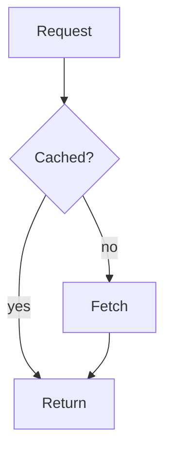

# slow

A terminal markdown viewer for long documents, with mermaid diagrams drawn in the terminal.

**slow is a fork of [Glow](https://github.com/charmbracelet/glow) by [Charm](https://charm.sh).**
It started from Glow's code and keeps its git history. The binary is called `slo`.

## What's different from Glow

- **Mermaid diagrams are drawn as text.** A ` ```mermaid ` block becomes a box-drawing
  diagram instead of showing its source. Flowcharts (top-down) and state diagrams are
  supported; anything else is shown as the original source block.
- **Files matched by `.gitignore` are listed.** Glow hides them. `--gitignore` brings that
  behaviour back. `node_modules`, `$GOPATH` and dot-directories are still skipped, and
  `-a` shows those too.
- **No 120-column cap, and centered.** The text follows the terminal width, including
  when it is resized, and is centered when it is narrower than the terminal.

Planned, not built yet: scroll acceleration, jumping between sections, a contents
sidebar and a debug bar. See [`plan/`](plan/).

## Install

Needs Go. Binaries for Linux, macOS and Windows are on the
[releases page](https://github.com/kinxyo/slow/releases).

```sh
git clone git@github.com:kinxyo/slow.git
cd slow
make prod      # builds slo and moves it to ~/bin
```

`make run` does the same without stripping the binary, `make test` runs vet and the
tests with the race detector.

## Use

```sh
slo                  # browse markdown files in the current directory
slo README.md        # render a file
slo -p README.md     # render and open in $PAGER
slo -t README.md     # open in the interactive viewer
slo github.com/kinxyo/slow
cat notes.md | slo -
```

| Flag                 | What it does                                                   |
|----------------------|----------------------------------------------------------------|
| `-p`, `--pager`      | display with a pager                                           |
| `-t`, `--tui`        | display with the interactive viewer                            |
| `-s`, `--style`      | style name or path to a JSON style (`dark`, `light`, `auto`…)  |
| `-w`, `--width`      | wrap at this width; `0` disables wrapping                      |
| `-a`, `--all`        | show system files and directories (viewer only)                |
| `--gitignore`        | skip files matched by `.gitignore` (viewer only)               |
| `-l`, `--line-numbers` | show line numbers (viewer only)                              |
| `-n`, `--preserve-new-lines` | keep newlines as written                               |

In the viewer, press `?` for the keys. Scrolling is `j`/`k`, `d`/`u` for half
pages, `g`/`G` for top and bottom, `e` edits the file, `r` reloads, `esc` goes back to
the file list and `q` quits.

## Mermaid



becomes, in the terminal, a diagram of boxes joined by arrows, with decision nodes as
boxes with slanted corners, dotted edges for `-.->` and dashed frames for subgraphs.

Supported: `flowchart`/`graph` with `TB` or `TD`, node shapes `[]` `()` `{}`, edges
`-->` `---` `-.->` `==>` with labels, `&` lists and one level of `subgraph`;
`stateDiagram-v2` with `[*]`, labelled transitions, `state "x" as y`, `<<choice>>` and
self-loops. Not supported: `LR`/`RL`/`BT`, nested subgraphs, composite states, sequence,
class and other diagram types. A block that can't be drawn, or doesn't fit the width, is
left as it is.

## Status

Early. The program still carries Glow's internals in places: the help text, the man
page and the config and cache directories (`~/.config/glow`, `~/.cache/glow`) still say
`glow`, and the Go module path is still `charm.land/glow/v3`. Renaming them is in
[`plan/00-repo-and-rebrand.md`](plan/00-repo-and-rebrand.md).

## Credits

slow is built on [Glow](https://github.com/charmbracelet/glow), © Charmbracelet, Inc.,
MIT licensed, and uses Charm's [glamour](https://github.com/charmbracelet/glamour),
[Bubble Tea](https://github.com/charmbracelet/bubbletea) and
[Lip Gloss](https://github.com/charmbracelet/lipgloss). Glow's name and logo belong to
Charm and are not used here.

## License

[MIT](LICENSE). Charm's copyright notice is kept, as the license requires.
